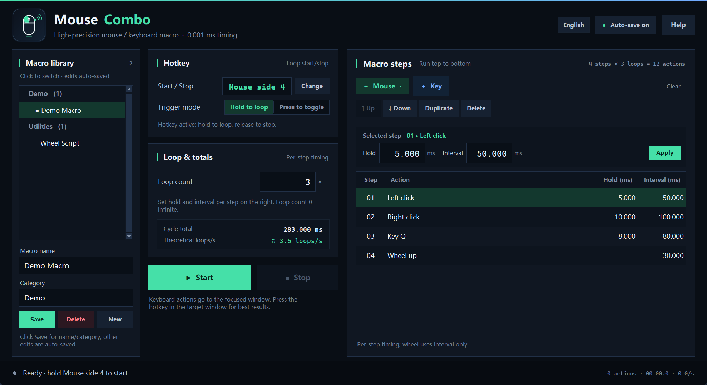

# Mouse Combo

**A high-precision mouse and keyboard macro tool for Windows 10/11.**

[Website](https://hutao48.github.io/mouse-combo/) · [Download installer](https://hutao48.github.io/mouse-combo/downloads/MouseCombo-Setup-1.5.6.exe) · [Install & risk guide](https://hutao48.github.io/mouse-combo/guide.en.html#signing) · [Public signing certificate](https://hutao48.github.io/mouse-combo/downloads/MouseCombo-CodeSigning.cer)

Mouse Combo is a local, offline macro utility with a single toggle hotkey, per-step timing, an inline macro library, and full keyboard repeat. The application interface can be switched between **Chinese, Japanese and English** from the language menu in the top-right corner. The website uses the same three-language switch; open `?lang=ja` or `?lang=en` for a direct localized link.



## Features

- **Per-step timing** — every mouse or keyboard step has its own hold duration and interval. Times are shown in the step table and edited independently; there is no global timing applied to the whole macro.
- **Mouse side-button hotkey** — use mouse side button 4 (back) or 5 (forward) as the start/stop key, optionally with Ctrl / Alt / Shift. The matched side button is swallowed system-wide.
- **Hold-to-loop or press-to-toggle** — hold the hotkey to run and release to stop, or press once to start and again to stop.
- **Inline macro library** — categorized macro files are displayed directly in the left sidebar. Click a name to switch, edit the name/category, save, delete or create a new macro without opening a folder or a separate manager window.
- **Full keyboard repeat** — letters, digits, symbols, F1–F24, arrows, numpad, media keys and Ctrl / Alt / Shift combinations.
- **0.001 ms timing step** — integer-nanosecond storage and an absolute cycle timeline. This is an internal timing resolution, not a guarantee of microsecond-accurate physical input.
- **Local and offline** — no telemetry, no network access required for normal use.

## Settings, theme and fonts

The **Settings** button in the top-right opens a dedicated settings page:

- **Theme**: follow Windows, light, or dark. Changing it restarts the window.
- **Font**: the bundled `assets/zh-cn.ttf` (Tk family `SDK_SC_Web`) or an installed system font such as Microsoft YaHei UI, Segoe UI, Yu Gothic UI, Meiryo UI or SimSun.
- **Font size**: 8–12 pt, applied as a relative scale to the whole UI.
- **Font color**: follow the theme or choose a custom color with the color picker.
- **Language**: Chinese / Japanese / English, with automatic restart.
- **Updates**: current version, GitHub source, automatic silent updates, manual check and GitHub Releases.
- **About & safety**: version, config folder, website, risk and uninstall information.

The hotkey, trigger mode, per-step timing and macro library stay on the main window; the settings page only manages global options. Theme and font changes apply after the automatic restart.

## Automatic updates

Starting with v1.5.2, the installed edition checks **GitHub Releases** about three seconds after launch. Silent updates are enabled by default:

- Source: `https://api.github.com/repos/hutao48/mouse-combo/releases/latest`.
- A newer release is downloaded in the background. The updater verifies `SHA256SUMS.txt` (or the GitHub asset digest), then starts a hidden PowerShell helper.
- The helper waits for Mouse Combo to exit, runs the installer with `/VERYSILENT /SUPPRESSMSGBOXES /NORESTART /CLOSEAPPLICATIONS /DIR="<current install dir>"`, and restarts the app on success.
- Updates never install while a macro is running; they wait until it stops. Failures are logged to `%APPDATA%\MouseCombo\updates\update.log`, and the same version is not retried automatically for 24 hours.
- The version button in the top-right can check manually, disable **Automatic silent updates**, or open GitHub Releases.
- Source-tree runs do not install updates automatically; a manual check opens the Releases page.
- The installer is still self-signed; SmartScreen may warn even for an automatic update.

The updater only contacts the GitHub API and GitHub release assets. It does not use the website `release.json` and does not upload local data.

## Code signing

The v1.5.6 application and installer are Authenticode-signed and timestamped with a **project self-signed code-signing certificate**. This is a real signature, but it is **not issued by a public CA**: Windows may still show “Unknown publisher” and SmartScreen will not grant reputation until the certificate is trusted on that machine.

```text
Subject:  CN=Mouse Combo, O=Mouse Combo, C=JP
SHA256:   9778EDB71B9D337AF1DAEAEEACB7B59F6A819C669BE7BCF0D5D874928DB9DCC7
Valid:    2026-11-02 → 2029-11-02
```

- Public certificate: [MouseCombo-CodeSigning.cer](downloads/MouseCombo-CodeSigning.cer)
- Verification and optional trust steps: [guide.en.html#signing](https://hutao48.github.io/mouse-combo/guide.en.html#signing)
- The generated `unins000.exe` is not separately signed.
- The private key is not included in the repository, installer or website.

Only trust the certificate after verifying the official SHA256. A CA-issued OV/EV certificate is required to remove the unknown-publisher warning; this project currently uses a self-signed certificate.

## Installation

1. Download `MouseCombo-Setup-1.5.6.exe` from the website or the [downloads](downloads/) folder.
2. Run the installer. The license page contains the complete installation guide and risk statement; choose **I accept** to continue, or **I do not accept** to exit without installing.
3. The default per-user install location is `%LOCALAPPDATA%\Programs\MouseCombo`; administrator rights are not required.
4. Launch Mouse Combo from the Start Menu or the optional desktop shortcut.

The application UI supports Chinese / Japanese / English. Open the language menu in the top-right corner and select a language; the window restarts in the selected language.

## Uninstall

Use **Settings → Apps → Mouse Combo**, or run `unins000.exe` in the install directory. The standard uninstaller removes the program, shortcuts, registry entry and `%APPDATA%\MouseCombo` user data. Back up any macros you want to keep first.

The in-app **Help → Risk statement → Do not accept and uninstall** action invokes the same standard uninstaller.

## Data locations

```text
%LOCALAPPDATA%\Programs\MouseCombo\          installed program
%APPDATA%\MouseCombo\settings.json           current settings
%APPDATA%\MouseCombo\macros\                 named/categorized macro files
%APPDATA%\MouseCombo\ui_state.json           last macro and UI language
%APPDATA%\MouseCombo\crash.log               written only after an exception
```

## Timing model

Each step stores `hold_ms` and `interval_ms` independently. The next step starts after the current step is released plus its own interval. Wheel steps have no hold phase. The total cycle is the sum of all step durations (wheel hold excluded).

Starting with v1.5.6, the complete action loop runs in a bundled native helper (`assets/timing.dll`): the absolute wait and `SendInput` call happen in C while ctypes releases the Python GIL. Every step is scheduled against an **absolute cycle timeline** anchored to QPC, so a late wake-up is absorbed by a shorter following wait instead of shifting every later step. The helper uses a 20 ms final busy-wait, a high-resolution QPC clock and `timeBeginPeriod(1)`; the macro thread uses Time-Critical/MMCSS scheduling, EcoQoS opt-out and an ideal CPU. When launched as administrator, the process temporarily uses `REALTIME_PRIORITY_CLASS` and restores it afterwards. The footer reports the measured maximum wait/injection-call error and the number of deadlines missed by more than 1 ms.

`0.001 ms` (1 µs) is the input/display and internal scheduling step. **A user-mode Windows application cannot make physical input timing identical to a preset**: actual delivery is still subject to `SendInput` latency, Windows scheduling, CPU load, USB polling (commonly 125–1000 Hz), the target application and security software. The footer statistic is native wait/injection-call latency, not physical device arrival. Hardware-level determinism requires a real-time OS, a microcontroller or a hardware macro device.

## Permissions and compatibility

Windows UIPI blocks synthetic input from normal processes to elevated windows. If the target application runs as administrator, run Mouse Combo as administrator as well. Some games and anti-cheat software block `SendInput`; please follow the target application's terms.

## Risk

This program generates real mouse and keyboard input. It can cause unintended clicks, data loss, account penalties, platform-rule violations or legal consequences. It is not suitable for medical, transportation, industrial control, financial trading or other high-risk use.

Read the complete [installation and risk guide](https://hutao48.github.io/mouse-combo/guide.html) before use.

**This project is for learning and reference only and must not be used for any illegal activity.**
